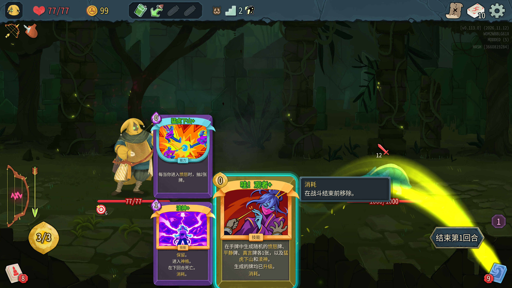

# 哇！观者 / Wah! Watcher

为《杀戮尖塔 2》**测试版 v0.113.0** 的愚者添加一张观者联动稀有牌，带原生「哇」旋律标签。


## 卡牌效果

**哇！观者** · 稀有 · 0 费技能 · 哇 · 消耗

在手牌中生成以下五张牌。

- 随机一张能够进入愤怒的牌。
- 随机一张能够进入平静的牌。
- 随机一张能够获得真言的牌。
- 猛虎下山。
- 渎神。

**升级后，生成的五张牌全部升级。** 生成牌保留自身费用；手牌已满时，多出的牌进入弃牌堆。支持简体中文、繁体中文和英文。

随机范围包含初始牌、条件触发及延迟触发的姿态牌。

| 类别 | 随机范围 |
| --- | --- |
| 愤怒 | Eruption、Crescendo、Indignation、Tantrum、SimmeringFury |
| 平静 | Vigilance、Tranquility、FearNoEvil、InnerPeace、Meditate |
| 真言 | Prostrate、Pray、Worship、Devotion |

## 下载与安装

从 [Releases](https://github.com/FurtherBank/wow-watcher-sts2/releases) 下载 `WowWatcher-0.1.1.zip`。

使用前请切换到游戏测试分支，并安装、启用以下前置 Mod。

| 前置 Mod | 已验证版本 |
| --- | --- |
| [BaseLib](https://steamcommunity.com/sharedfiles/filedetails/?id=3737335127) | 3.4.8 |
| [The Watcher](https://steamcommunity.com/sharedfiles/filedetails/?id=3747492505) | 1.5.16 |

解压安装包，将 `WowWatcher` 文件夹放入游戏的 `mods` 目录。该文件夹内应直接包含 `WowWatcher.dll`、`WowWatcher.pck`、`WowWatcher.json` 三个文件。启用本 Mod 并重启游戏，即可在愚者牌池中获得此牌。

- Windows、Linux：游戏安装目录下的 `mods/WowWatcher`。
- macOS：`SlayTheSpire2.app/Contents/MacOS/mods/WowWatcher`。

当前验证范围为 **macOS、测试版 v0.113.0**。安装包不包含游戏或前置 Mod 的文件。

## 游戏内预览



## 从源码构建

需要 .NET 9 SDK、Python 3、Godot 4.5.1 的 .NET SDK（由项目自动还原），以及本地的游戏和前置 Mod。游戏程序集、BaseLib 和 Watcher 均通过本地文件引用，不随源码分发。

macOS 默认使用当前用户的标准 Steam 安装目录。其他位置或平台可在仓库根目录创建已被 Git 忽略的 `local.props`。

```xml
<Project>
  <PropertyGroup>
    <GameData>/path/to/directory/containing/sts2.dll</GameData>
    <Workshop>/path/to/steamapps/workshop/content/2868840</Workshop>
  </PropertyGroup>
</Project>
```

`Workshop` 目录需要包含 `3737335127/BaseLib/BaseLib.dll` 和 `3747492505/Watcher.dll`。`GameData` 目录还应包含游戏随附的 `0Harmony.dll`。

```sh
./scripts/build.sh
```

若 .NET 不在 PATH 中，可设置 `DOTNET_BIN` 为本机 `dotnet` 可执行文件的路径。Windows 可使用 Git Bash 或 WSL 执行脚本，并安装相应环境下可用的 .NET 和 Python。

输出为 `dist/WowWatcher/` 和 `dist/WowWatcher-0.1.1.zip`。ZIP 内只有运行所需的 DLL、PCK 和清单。

## 卡图与资源

专属卡图使用 imagegen 生成，参考愚者「哇」牌与观者牌的角色造型和视觉语言，展示观者用两指接住愚者指挥棒的瞬间。

- [生成原图](WowWatcher/images/wah_watcher.png)
- [生成提示词](art/generation-prompt.txt)
- `WowWatcher/images/wah_watcher.res` 为保留原图像素的 Godot 纹理资源。

PNG 和 `.res` 均已包含在仓库中，普通构建无需重新生成。若替换 PNG，先用 .NET 版 Godot 4.5 更新纹理，再重新构建。

```sh
godot --headless --path . --script scripts/import_art.gd
```

将 `godot` 替换为本机 Godot .NET 编辑器的可执行文件名或路径。

本项目是非官方同人 Mod。《杀戮尖塔 2》及其角色属于 Mega Crit；观者移植 Mod 由 lamali 制作。本仓库未收录参考卡图或游戏程序集；游戏截图仅用于展示 Mod 的实际效果。

## 验证记录

已使用独立游戏副本和独立存档，从愚者选角、开局、进入战斗到实际出牌，验证以下行为。

- 注册到愚者牌池，稀有度、中文名称和描述正确。
- 专属卡图在普通版和升级版中正确显示，原生金框正常。
- 0 费，三类随机牌各一张，固定生成猛虎下山和渎神。
- 原版生成未升级牌，升级版生成五张升级牌。
- 打出后消耗，原生旋律系统识别为「哇」。
- 手牌接近满额时，溢出的牌进入弃牌堆。

结果见 [功能验证](verification/results.txt)、[卡图验证](verification/art-results.txt)。测试进程退出码为 0；退出时出现 Godot 渲染资源释放提示，未影响上述断言通过。当前仓库收录验证结果和截图，未提供自动执行这些游戏场景的测试工具。
